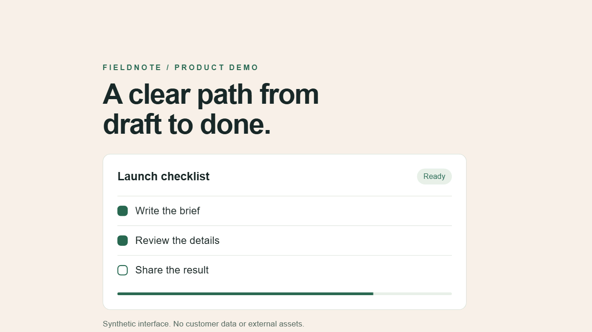

<p align="center"></p>

# remotion-product-motion

Create fluid, readable product showcase videos in Remotion.

An agent skill for camera choreography, authentic interface animation, hard cuts with motion blur, sound placement, and evidence-based render review. Use continuous travel when it suits the film; static shots and silent demos are equally valid.



[Watch the silent example](assets/demo.mp4).

## Install the skill

For agents supporting the Skills CLI:

```sh
npx skills add hamgarian/remotion-product-motion --skill remotion-product-motion
```

For Codex, copy `skills/remotion-product-motion` into your Codex skills directory (usually `~/.codex/skills/`), then start a new turn. For Claude Code, copy that same folder into `.claude/skills/` in your project. The installable folder contains all instructions, references and optional helpers; the repository demo is not required.

Example request:

> Use remotion-product-motion to create a product walkthrough from our actual UI. Keep the labels readable, connect the main actions with layered camera travel, and report the frames and exports you checked.

## Run the example and checks

Use Node.js 24 and npm. The example is a synthetic interface with no remote fonts, music or customer assets. Remotion downloads its browser on the first render; allow network access and sufficient disk space. Review [Remotion's license](https://www.remotion.dev/license) for your use of its dependencies; this repository's original material is MIT.

```sh
git clone https://github.com/hamgarian/remotion-product-motion.git
cd remotion-product-motion
npm ci
npm run check
npm run test:render -- --video
npm run studio
```

`check` runs helper tests and TypeScript. `test:render` renders sampled-selection controls and fixed-selection fixtures with both blur implementations, asserts fixed-background pixel purity around the cut, checks moving-marker spread against unblurred baselines, and renders landscape/portrait review frames. It requires the canvas control to reproduce ghosting; the fallback control is recorded because its sampling phase differs. `--video` also encodes the landscape demonstration to `out/product.mp4`. The render script writes machine-readable evidence to `out/render-check.json`. New outputs stay out of Git history; selected first-release evidence is included under `assets/` and `docs/`.

In Studio, select `ProductLandscape` or `ProductPortrait`. The compositions are seven seconds at 30 fps. Adapt the source to your requested duration and format; these settings are demo choices.

## What the skill changes

- Build a shot plan around action, result and reading time.
- Overlap independently timed pan/dolly tracks and inspect the focal point after all transforms compose.
- Preserve native UI behavior with a deterministic frame clock and verify arbitrary seeking.
- Select discrete hard-cut content once per output frame while continuous motion receives fractional shutter samples.
- Align sound to its audible attack, then distinguish signal analysis from actual listening.
- Optimize using representative frame comparisons; verify quality and chunk seams before a full export.

The optional dependency-free [motion helpers](skills/remotion-product-motion/scripts/motion.mjs) expose clamped timing, stable exponential easing, camera projection, discrete cut selection, cue placement and ducking envelopes. See [the helper contract](docs/helpers.md).

## Evidence and boundaries

See [validation](docs/validation.md) for executed checks, independent evaluation and remaining limits, and [sources](docs/sources.md) for primary references. The pixel regression checks solid backgrounds at screen cuts; it does not certify every text edge, motion path, or browser. The silent synthetic demo is not an audio-quality test. A still-frame review does not prove satisfying real-time pacing.

This is practical guidance assembled from production revisions, not a claim that exponential easing, beat sync or temporal sampling are new inventions. It is independent community material, with no affiliation or endorsement implied.

[Social preview](assets/social-preview.png) · [Changelog](CHANGELOG.md) · [MIT license](LICENSE)
